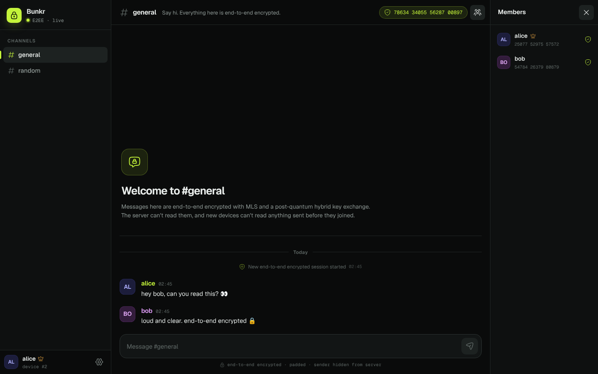
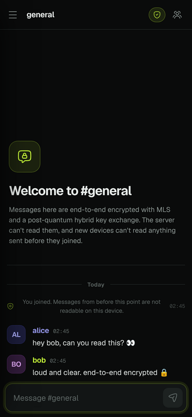

<div align="center">


# bunkr

**A self-hosted, Discord-style group chat where the server knows nothing.**

Post-quantum MLS end-to-end encryption · 100% Rust · Web, mobile browser, macOS, Linux, Windows (x64 + ARM)

</div>

<p align="center">
  
  &nbsp;
  
</p>

---

## Self-host in one command

You need a Linux VPS with Docker installed.

```bash
git clone https://github.com/rexsystems/bunkr && cd bunkr && docker compose up -d --build
```

Bunkr is now on `http://YOUR_SERVER:8080`.

**With a domain and automatic HTTPS (recommended):** point a DNS `A` record at the VPS, then run:

```bash
BUNKR_DOMAIN=chat.example.com docker compose --profile tls up -d --build
```

Caddy fetches and renews the Let's Encrypt certificate for you.

Or run the guided installer, which asks for the domain and prints the setup code:

```bash
./install.sh
```

### First login = admin

On first start the server prints a one-time **setup code** in its logs:

```bash
docker compose logs bunkr | grep -A1 "SETUP CODE"
```

Open Bunkr, enter the code and create the first account. That account is the **admin**.

> [!IMPORTANT]
> Use HTTPS in production. The browser downloads the encryption code from your server. Over plain HTTP, anyone on the network path could swap that code.

### Configuration

| Variable | Default | What it does |
|---|---|---|
| `BUNKR_DOMAIN` | – | Domain for automatic HTTPS (with `--profile tls`) |
| `BUNKR_NAME` | `Bunkr` | Server name shown in the app |
| `BUNKR_RETENTION_DAYS` | `30` | Ciphertext older than this is deleted from the server |
| `BUNKR_PORT` | `8080` | Host port (plain HTTP mode) |
| `BUNKR_SETUP_CODE` | random | Fixed first-run setup code, if you prefer to set your own |

Put them in a `.env` file next to `docker-compose.yml`, or prefix the command with them.

**Update:** `git pull && docker compose up -d --build`
**Backup:** the `bunkr-data` Docker volume (a single SQLite file).

---

## Apps

| Platform | How |
|---|---|
| **Browser (desktop + phone)** | Open your server URL. The layout is responsive, with a drawer and bottom sheet on phones. Use "Add to Home Screen" to install it like an app. |
| **macOS** (Apple Silicon + Intel) | `.dmg` from [Releases](../../releases) |
| **Windows** (x64 + ARM64) | `.msi` / `-setup.exe` from Releases |
| **Linux** (x64 + ARM64) | `.AppImage` / `.deb` / `.rpm` from Releases |

The desktop apps are a thin [Tauri](https://tauri.app) shell around the same Rust/WASM client. On first launch, enter your server address. To build the apps, push a tag (`git tag v0.1.0 && git push --tags`). GitHub Actions then builds all six targets into a draft release.

---

## Security model

Bunkr's server is a **zero-knowledge delivery service**. It routes and stores opaque ciphertext and nothing else.

### Encryption
- **Every channel is an [MLS](https://www.rfc-editor.org/rfc/rfc9420) group** ([OpenMLS](https://github.com/openmls/openmls)), with forward secrecy and post-compromise security.
- **Post-quantum hybrid ciphersuite:** `MLS_128_MLKEM768X25519_AES256GCM_SHA384_Ed25519`. Key exchange combines ML-KEM-768 and X25519, so it stays secure if either one holds.
- **Messages are padded** to 256-byte blocks so their length leaks less.
- **New devices cannot read history** from before they joined. That is how MLS works, and it is intentional.

### Identity
- Your password never leaves the device. **Argon2id** (64 MiB, 3 passes) derives two keys from it:
  - an `auth_key`, which proves who you are (the server stores only a hash of it);
  - a `master_key`, which never leaves the device and encrypts your account key and the local vault.
- Every account has an **Ed25519 identity key**, and every device is **signed by it**. Members' apps refuse to add a device whose signature doesn't verify, so **a malicious server cannot inject a device into a channel**.
- Account keys are pinned on first use. If someone's key changes, everyone sees a **"new identity"** warning.
- Fingerprints and a per-channel **epoch security code** can be compared out-of-band to rule out a man-in-the-middle.

### 🔥 Password change = total reset
Changing your password:
1. creates a brand-new identity key;
2. logs out **every** device (including the current one);
3. removes you from every encrypted group, so other members' apps evict your old devices;
4. wipes local history everywhere.

Then you log in fresh with the new password, under a new identity. **There is no password recovery.** If you lose the password, the account is gone.

If a session is revoked (password changed elsewhere, logout, ban), the app **wipes its local vault immediately**.

### Minimal data
The server stores **only**: username, password-hash-of-a-derived-key, salt, public identity key, encrypted account key, device public keys, and channel ciphertext.

It does **not** store: who sent a message, IP addresses, emails, phone numbers, user agents, or exact timestamps (only the hour, for retention). It writes no request logs. Ciphertext is deleted after `BUNKR_RETENTION_DAYS`, or sooner in channels with **disappearing messages**.

### On the device
Everything local (MLS state, keys, message cache, session token) lives in an encrypted **vault** (XChaCha20-Poly1305 with the master key). You need your password to unlock it every time the app opens. The **Panic** button wipes it instantly.

### Hardening
Strict CSP (no inline scripts, no third-party anything), `frame-ancestors 'none'`, `no-referrer`, a login rate limiter, constant-time comparisons, salts that don't reveal whether an account exists, and a non-root, read-only distroless container.

> [!WARNING]
> Bunkr has **not** been independently audited. It is built on well-reviewed libraries (OpenMLS, RustCrypto), and the protocol is covered by end-to-end tests. Until an audit happens, treat it as "very strong, unaudited".

---

## Admin

The admin's settings include **Users** and **Channels** tabs:
- **Ban / unban** a user. A ban kills all their devices instantly and evicts them from every encrypted group.
- **Delete** accounts, **promote/demote** admins.
- **Create / rename / delete channels.** Everyone is automatically in every channel, like a single Discord server.
- Set **disappearing messages** per channel (1 hour up to 90 days).
- **Open or close registration.**
- **Delete any message** for everyone. Admins can only delete messages, not read more than other members can.

---

## Architecture

```
crates/
  proto/    wire types shared by server & clients
  core/     ALL client crypto: Argon2id, vault, account keys, OpenMLS groups, sync engine
  server/   axum + SQLite + WebSocket delivery service (no crypto keys, ever)
  web/      Leptos (Rust → WebAssembly) UI, Hugeicons, Geist font
  e2e/      real-server protocol tests (join races, reset, ban, re-founding, no plaintext on disk)
desktop/    Tauri 2 shell for macOS / Windows / Linux
```

How a channel stays encrypted:

1. The first device to arrive **founds** the channel's MLS group.
2. New devices upload signed MLS KeyPackages. The server queues a "join".
3. Any online member's app verifies the device signature, **commits the add**, and the server delivers the Welcome.
4. If no member is online for a few seconds, the waiting device **re-founds** the group (new keys). Returning members are added back automatically.
5. The server enforces one ordered log per channel (epoch check). That avoids forks without the server ever seeing keys.

### Develop

```bash
# server
cargo run -p bunkr-server            # http://localhost:8080, data in ./data
# web client (needs: rustup target add wasm32-unknown-unknown, wasm-bindgen-cli 0.2.130)
./scripts/build-web.sh               # -> crates/web/dist (served by the server)
# tests (spawns a real server)
cargo build -p bunkr-server && cargo test -p bunkr-core -p bunkr-e2e
# desktop
cd desktop && npm install && npx tauri dev
```

Icons: [Hugeicons](https://hugeicons.com) free set (MIT), regenerated with `node scripts/gen-icons.mjs`. Font: [Geist](https://vercel.com/font) (OFL).

---

## License

AGPL-3.0-or-later
